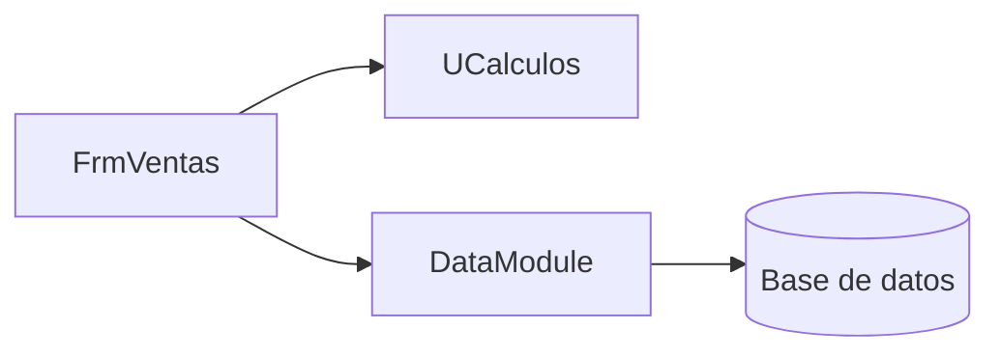
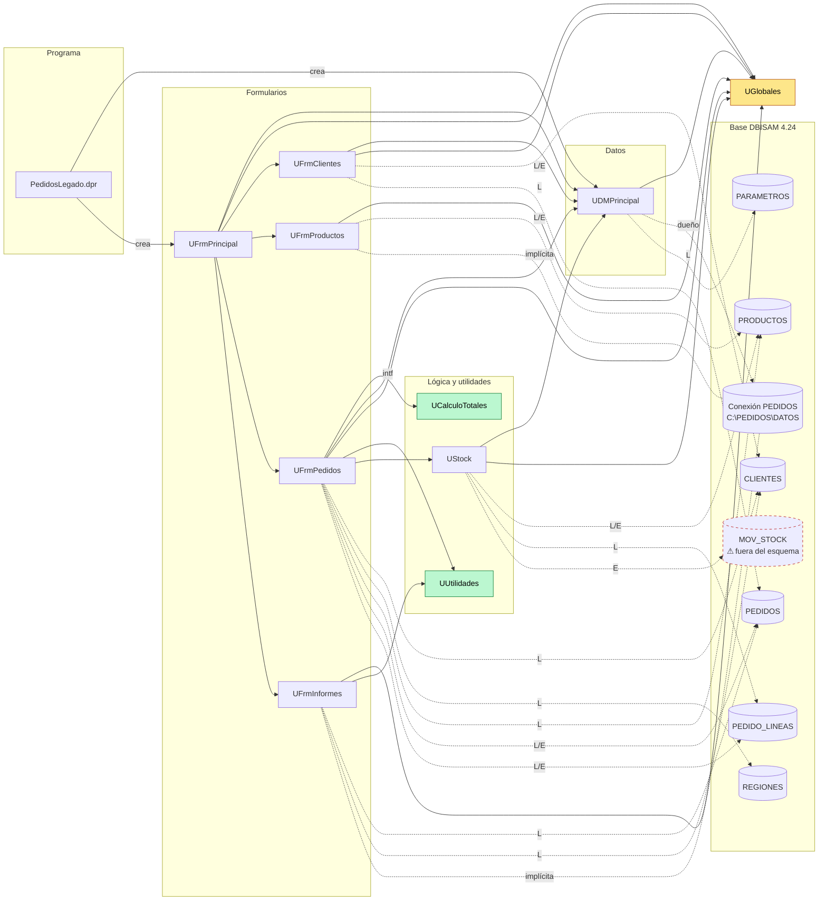

# Dependencias de Pedidos Legado

<!--
Etapa 1 · Entender (plan mode).
Dibuja quién usa a quién: unidades, formularios y la base de datos.
- Una flecha A --> B significa «A usa a B» (lo ves en la cláusula uses o en una consulta SQL).
- Incluye la base de datos (DBISAM) como un nodo: es parte del sistema.
Punto de control E1: el diagrama incluye la base de datos.

Ejemplo genérico (de otro sistema, no de este):

-->

**Leyenda**
- `-->`: dependencia por `uses`.
  - `intf`: único `uses` en la sección interface (`UFrmPedidos.pas:9`); los demás están en implementation.
  - `crea`: formularios que crea el `.dpr` (`PedidosLegado.dpr:21-22`). El `.dpr` también declara en `uses` las 10 unidades (`:5-14`); esas flechas se omiten para que el diagrama se pueda leer.
- `-.->`: acceso a datos, por SQL o por `TableName` en el `.dfm`. L = lectura, E = escritura.
- `-.-` implícita: el formulario usa la conexión `'PEDIDOS'` desde su `.dfm` (`UFrmProductos.dfm:87`, `UFrmInformes.dfm:150`) sin declarar `UDMPrincipal`. Solo funciona si `UFrmPrincipal` ya conectó la base (`UFrmPrincipal.pas:51`).
- Colores:
  - Amarillo: la unidad que casi todas usan.
  - Verde: unidades puras (sin formularios ni base).
  - Borde discontinuo rojo: tabla que no está en el esquema.

**Notas**
- `UFrmPrincipal` lee PARAMETROS a través de `DMPrincipal.LeerParametro` (`UFrmPrincipal.pas:62,65` → `UDMPrincipal.pas:85`).
- `UDMPrincipal` también abre CLIENTES, PRODUCTOS, PEDIDOS, PEDIDO_LINEAS y PARAMETROS como tablas (`UDMPrincipal.pas:62-66`), pero ninguna unidad las usa: los formularios abren las suyas (`tblCli`, `tblProd`) o arman sus propias queries. No se dibujan para no duplicar aristas.
- No hay FK declaradas en `esquema-dbisam.sql`. Las relaciones entre tablas están en [inventario.md](inventario.md#tablas-de-la-base-dbisam-424).

## Preguntas guía

1. **¿Qué unidad usan casi todas las demás? ¿Qué pasaría si cambia?**
   - **`UGlobales`** está en el `uses` de las 7 unidades que dependen de otras unidades propias: UDMPrincipal, UStock y los 5 formularios. Guarda variables globales que cualquiera puede modificar (`gUsuario`, `gNivelUsuario`, `gTasaIVA`, `gRutaDatos`, banderas). Si cambia el nombre, el tipo o el valor por defecto de una de ellas, se ven afectados el login, los permisos, el IVA y la conexión, todo a la vez y sin que el compilador lo avise.
   - Además, el orden importa: `UDMPrincipal.Conectar` usa `gRutaDatos` (`UDMPrincipal.pas:60`), y esa variable solo tiene valor después de `InicializarGlobales` (`UFrmPrincipal.pas:45`, antes de `Conectar` en `:51`).
   - Detrás le sigue **`UDMPrincipal`**: es la única puerta a la base que declaran en `uses` 4 unidades, y otras 2 la usan de forma implícita.
2. **¿Qué unidad no depende de formularios ni de la base de datos? ¿Por qué eso importa para migrar?**
   - **`UCalculoTotales`** (solo `SysUtils`, `UCalculoTotales.pas:44-45`) y **`UUtilidades`** (solo `SysUtils` y `DateUtils`, `UUtilidades.pas:24-25`), además de `UGlobales`, que no tiene lógica.
   - Las dos primeras se pueden traducir a `PedidosWeb.Core` sin arrastrar la VCL ni DBISAM y cubrirse con tests xUnit desde el primer día.
   - Ojo: `UCalculoTotales` **no** es la regla que se graba. El total que va a la base lo calcula `UFrmPedidos` con otro umbral (`>=` en `UFrmPedidos.pas:296` frente a `>` en `UCalculoTotales.pas:77`) y con el descuento de Navidad. Antes de migrar hay que decidir cuál es la regla oficial.
