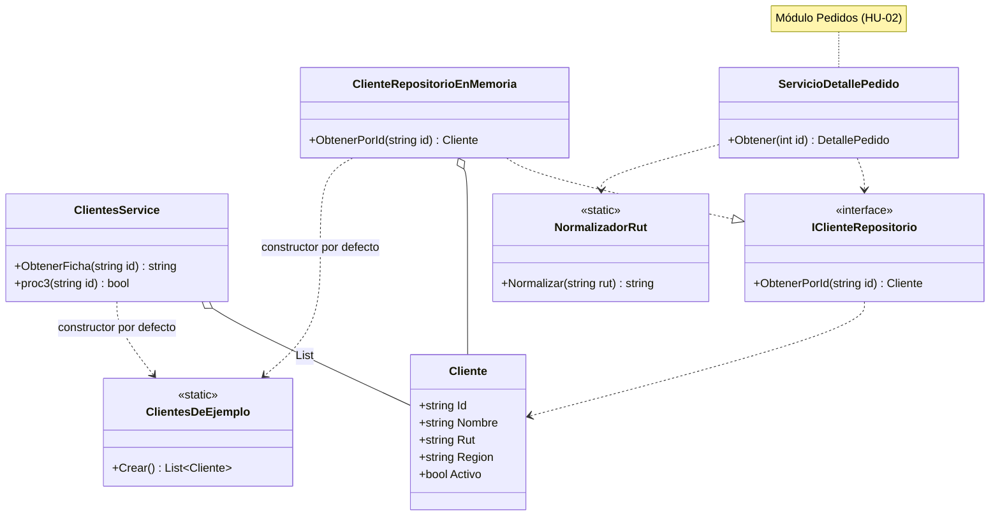

# Módulo Clientes

Carpeta: `src/PedidosWeb.Core/Clientes/` · Namespace: `PedidosWeb.Core.Clientes`
Tests: `tests/PedidosWeb.Core.Tests/Clientes/ClientesServiceTests.cs`

## Propósito

Reúne los datos de los clientes de la distribuidora y dos formas de consultarlos:

- **`ClientesService`**: servicio heredado. Arma la ficha de un cliente para la pantalla y dice si un cliente está activo.
  Lo escribió un ex integrante del equipo y tiene 4 tests. Hoy no lo usa la API ni otro módulo: solo sus tests.
- **`IClienteRepositorio`** y **`NormalizadorRut`**: se agregaron con la HU-02 (`specs/HU-02-detalle-pedido/spec.md`).
  `ServicioDetallePedido` (módulo Pedidos) los usa para poner el RUT y la región del cliente en el detalle de un pedido.

Los 8 clientes son ficticios (`C-001` a `C-008`) y son los mismos de los 45 pedidos de ejemplo.
Los RUT vienen escritos como en el sistema legado: con puntos, con espacios o con la `k` en minúscula.

| Archivo | Contenido |
|---|---|
| `src/PedidosWeb.Core/Clientes/Cliente.cs` | Modelo del cliente. |
| `src/PedidosWeb.Core/Clientes/ClientesDeEjemplo.cs` | Los 8 clientes de ejemplo. |
| `src/PedidosWeb.Core/Clientes/ClientesService.cs` | Servicio heredado: ficha y estado del cliente. |
| `src/PedidosWeb.Core/Clientes/IClienteRepositorio.cs` | Interfaz para buscar un cliente por id. |
| `src/PedidosWeb.Core/Clientes/ClienteRepositorioEnMemoria.cs` | Implementación en memoria del repositorio. |
| `src/PedidosWeb.Core/Clientes/NormalizadorRut.cs` | Normaliza un RUT escrito como en el legado. |

## API pública

### `Cliente` (`class`)
Un cliente de la distribuidora. Clase mutable, con propiedades `get; set;`.

| Propiedad | Tipo | Qué guarda |
|---|---|---|
| `Id` | `string` | Código del cliente, por ejemplo `"C-001"`. |
| `Nombre` | `string` | Nombre del cliente. |
| `Rut` | `string` | RUT tal como lo guarda el legado (sin normalizar). |
| `Region` | `string` | Código de región: `"RM"`, `"II"`, `"V"` o `"VIII"` en los datos de ejemplo. |
| `Activo` | `bool` | Si el cliente está activo. |

### `ClientesDeEjemplo` (`static class`)
```csharp
public static List<Cliente> Crear()
```
Devuelve una lista nueva con los 8 clientes de ejemplo cada vez que se llama. `C-007` (Kiosco Central) es el único inactivo.

### `ClientesService` (`class`, heredado)
```csharp
public ClientesService()
```
Usa los 8 clientes de `ClientesDeEjemplo.Crear()`.

```csharp
public ClientesService(List<Cliente> l)
```
Usa la lista que recibe.

```csharp
public string ObtenerFicha(string id)
```
Devuelve la ficha del cliente como texto `"Nombre | RUT | Zona | Estado"`, o `""` si no hay un cliente con ese `Id`.
- Busca por `Id` exacto (distingue mayúsculas).
- RUT: quita puntos y espacios y lo pasa a mayúsculas.
- Zona según `Region`: `RM` y `V` → `Zona centro`; `VIII` → `Zona sur`; `II` → `Zona norte`; cualquier otra → `Sin zona`.
- Estado: `Activo` o `Inactivo`.

```csharp
public bool proc3(string id)
```
Devuelve `true` si el cliente existe y está activo; `false` si está inactivo o no existe.

### `IClienteRepositorio` (`interface`)
```csharp
Cliente? ObtenerPorId(string id)
```
El cliente con ese id, o `null` si no existe.

### `ClienteRepositorioEnMemoria` (`sealed class`, implementa `IClienteRepositorio`)
```csharp
public ClienteRepositorioEnMemoria()
```
Usa los 8 clientes de `ClientesDeEjemplo.Crear()`.

```csharp
public ClienteRepositorioEnMemoria(IEnumerable<Cliente> clientes)
```
Usa los clientes que recibe. Los tests de HU-02 lo usan con una lista vacía para simular un cliente desconocido.

```csharp
public Cliente? ObtenerPorId(string id)
```
Busca por `Id` exacto (distingue mayúsculas); `null` si no lo encuentra.

> En la API se registra con una fábrica: `AddSingleton<IClienteRepositorio>(_ => new ClienteRepositorioEnMemoria())`
> (`src/PedidosWeb.Api/Program.cs`). Si se registra solo con el tipo, el contenedor elige el constructor
> `(IEnumerable<Cliente>)` y le pasa una lista vacía.

### `NormalizadorRut` (`static class`)
```csharp
public static string Normalizar(string rut)
```
Quita puntos y espacios y pasa a mayúsculas: `"76.990.011-k"` → `"76990011-K"`; `"76 432 198-7"` → `"76432198-7"`.
No valida el dígito verificador.

## Ejemplo de uso

Ficha y estado con el servicio heredado. Los resultados son los de `ClientesServiceTests`:

```csharp
using PedidosWeb.Core.Clientes;

var servicio = new ClientesService(); // los 8 clientes de ejemplo

servicio.ObtenerFicha("C-001"); // "Ferretería El Clavo | 76123456-0 | Zona centro | Activo"
servicio.ObtenerFicha("C-004"); // "Almacén La Esquina | 76990011-K | Zona centro | Activo"  (RUT guardado "76.990.011-k")
servicio.ObtenerFicha("C-999"); // ""  (no existe)

servicio.proc3("C-001");        // true   (activo)
servicio.proc3("C-007");        // false  (inactivo)
servicio.proc3("C-999");        // false  (no existe)
```

Repositorio y RUT normalizado, como los usa `ServicioDetallePedido` en la HU-02:

```csharp
IClienteRepositorio clientes = new ClienteRepositorioEnMemoria();

var cliente = clientes.ObtenerPorId("C-004");    // Almacén La Esquina, Region "V"
var rut = NormalizadorRut.Normalizar(cliente!.Rut); // "76990011-K"  (ServicioDetallePedidoTests, CA-06)

clientes.ObtenerPorId("C-999");                  // null
```

## Diagrama



En el diagrama, `ObtenerPorId` y `Obtener` pueden devolver `null` (en C#: `Cliente?` y `DetallePedido?`).

## Tests

`tests/PedidosWeb.Core.Tests/Clientes/ClientesServiceTests.cs` cubre `ClientesService`:

| Test | Qué comprueba |
|---|---|
| `Proc2_ClienteInexistente_DevuelveTextoVacio` | `ObtenerFicha("C-999")` → `""` |
| `Proc2_ClienteActivo_DevuelveLaFicha` | `ObtenerFicha("C-001")` → ficha completa |
| `Proc2_RutConPuntosYKMinuscula_LoNormaliza` | `ObtenerFicha("C-004")` → RUT `76990011-K` |
| `Proc3_ClienteActivoEInactivo_DevuelveSiEstaActivo` | `proc3` con C-001, C-007 y C-999 |

Los nombres de test conservan el prefijo `Proc2_` del nombre anterior de `ObtenerFicha`.
`ClienteRepositorioEnMemoria` y `NormalizadorRut` no tienen tests propios: se prueban a través de
`tests/PedidosWeb.Core.Tests/Pedidos/ServicioDetallePedidoTests.cs` (CA-05 a CA-07 de la HU-02).
